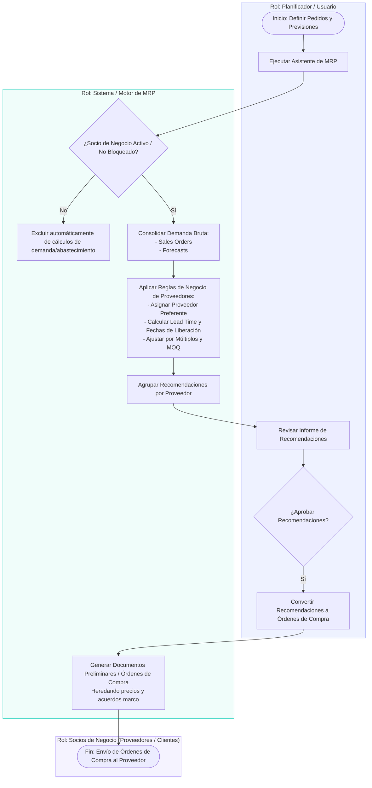

# Proceso MRP y Socios de Negocio (BPMN)

Este diagrama representa el flujo de interacción entre los **Socios de Negocio**, el **Motor de MRP** y el **Planificador**, basado en la notación BPMN (*Business Process Model and Notation*).

---
### Resumen del Flujo
1. **Validación:** Se filtran automáticamente los Socios de Negocio bloqueados o inactivos.
2. **Cálculo y Reglas:** Se consolidan *Sales Orders* y *Forecasts*, aplicando *Lead Time*, *MOQ* y proveedor preferente.
3. **Generación:** Al aprobar las recomendaciones, se emiten las Órdenes de Compra correspondientes heredando las condiciones comerciales.